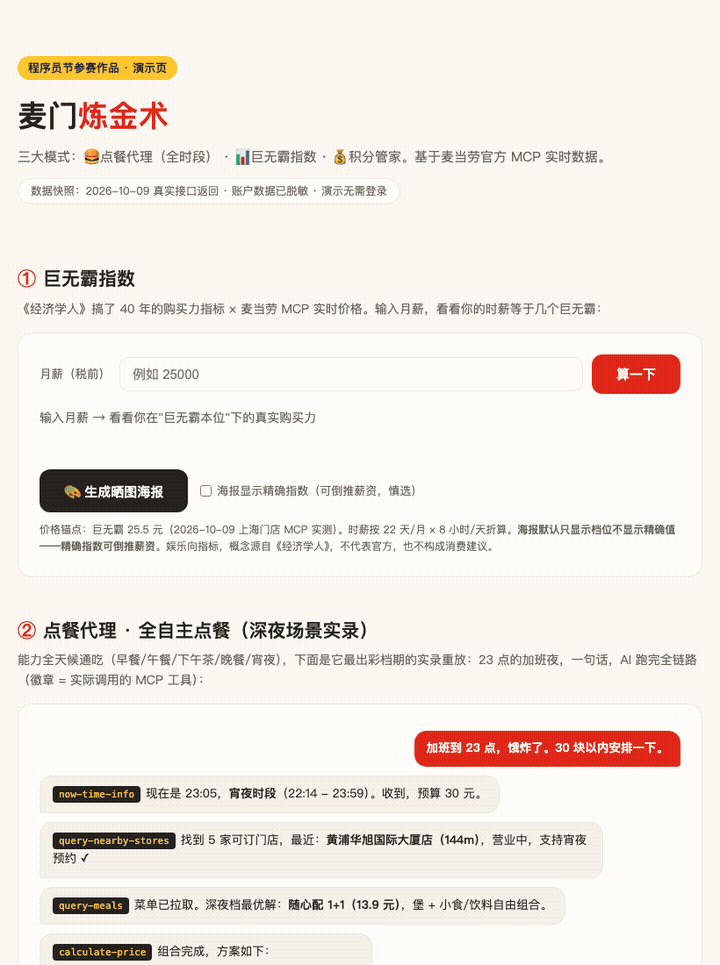

# 麦门炼金术 · McD Alchemy

> 把每一块钱、每一分积分、每一个深夜的饥饿感，都安排得明明白白。
> 基于麦当劳官方 MCP（mcd-order）的全场景消费副驾驶 —— 三大模式，三种人群，一个 Skill。


   



*▲ 30 秒看完它能干什么：算巨无霸指数 → 抽奖保底分析 → 模拟器试抽 → 性价比榜 → 生成晒图海报（点击上方在线演示链接可亲自玩）*

## 先看两个数

| | |
|---|---|
| **+6 积分** | 抽奖单次成本 24 分，公开奖池最低奖品 30 分——**最差也是赚的**（按公开奖池推断，概率未公示） |
| **5 倍价差** | 同样是积分兑换：50 分换派 ≈ **0.13 元/分**，800 分换巨无霸组合 ≈ **0.027 元/分**——换大额组合的人，每分积分只发挥了 1/5 的价值 |

价值率公式：`价格 ÷ 所需积分`，所有推荐都经 `calculate-price` 实时复核——**算账交给公式，表达交给 Agent**。

| 模式 | 给谁用 | 干什么 |
|---|---|---|
| 🍔 **点餐代理** | 任何想吃麦当劳的人，早餐到宵夜全时段 | 一句话"30 块安排晚饭"——AI 自己判断时段、查门店、组合菜单、算券、建单，甩给你支付链接。**看 AI 自主跑完全链路本身就是内容**（深夜档绰号"夜航员"） |
| 📊 **巨无霸指数** | 任何领工资的人（零门槛） | 输入月薪，"你的时薪 = 1.4 个巨无霸"。经济学概念 × 实时价格 × 自嘲传播 |
| 💰 **会员资产管家** | 麦当劳会员 | 过期积分预警、抽奖保底分析、商城性价比榜、每日活动简报 |

三条腿站得稳：点餐代理是**主力功能**、指数是**传播**、管家是**留存**——互不依赖，合在一起是"全场景消费副驾驶"。

**对话即分析 · 每日简报主动找你 · 在线 demo 可玩** —— 一个开源的麦当劳个人消费 Copilot。

## 两个反直觉的发现

**发现一：积分抽奖，最差也是赚的？**

> 公开奖池实测（2026-10-09 首测，**2026-10-19 复测结论不变**，活动有效期至 2030 年）：
> 积分抽奖 **24 积分/次**，奖池 10 项中唯一有确定积分价值的奖品是 **30 积分**——
> 也就是说，**抽一次最差净赚 6 积分**，其余 9 项全是真实优惠券（立减 3/2/1 元券、多张 5 折券）。
> （"保底"指公开奖池最低确定价值项与成本的差值推断：券类奖品需消费兑现、官方未公示概率，实际以活动页为准。）

**发现二：用积分换巨无霸套餐，账面竟然不省？**

> 同一顿巨无霸午餐（2026-10-09 上海某门店实测菜单）：
>
> | 买单方式 | 你付出的 | 折算成本 | 结论 |
> |---|---|---|---|
> | 单点（堡 25.5 + 薯条 13.5 + 可乐 9.5） | 48.5 元 | 48.5 元 | 最贵，不用动脑 |
> | 官方三件套 | 36.5 元 | 36.5 元 | 省 12 元，无脑选 |
> | 800 积分换「21.9 元巨无霸可乐组合」券 | 800 分 + 21.9 元 | ≈ 43.8 元* | 账面不省，只是积分的"保本出口" |
>
> \* 折算口径：按积分标尺 0.0274 元/分（21.9 元 ÷ 800 分），800 分 ≈ 21.9 元等值。
> 积分真正的最优出口是小额定向券：50 分换 6.9 元派券，价值率 0.138 元/分，是巨无霸组合的 **5 倍**。

这些结论都能用 MCP 实时数据复现——本项目把"算账"过程工具化了。

## 它能做什么（三大模式 × 九个能力）

| 模式 | 能力 | 背后的 MCP 工具 |
|---|---|---|
| 🍔 点餐代理 | 时段判断 → 附近门店 → 预算内组合 → 券优化 → 建单出支付链接（全时段） | `now-time-info` + `query-nearby-stores` + `query-meals` + `query-store-coupons` + `calculate-price` + `create-order` |
| 📊 巨无霸指数 | 实时价格锚点 + 时薪购买力 + 万物换算 + 晒图文案 | `query-meals` |
| 💰 管家·过期预警 | 积分过期倒计时 + 最优消耗路径 | `query-my-account` + `mall-points-products` |
| 💰 管家·抽奖保底 | 保底速算 + 期望区间 + 决策建议 | `query-lottery-info`（+确认后 `draw-lottery`） |
| 💰 管家·性价比榜 | 商城"元/分"标尺统一排序 | `mall-points-products` |
| 💰 管家·活动简报 | 今日/明日活动 + 一键领券 | `campaign-calendar` + `available-coupons` |

## 三种打开方式

| 端 | 形态 | 适合谁 |
|---|---|---|
| 💬 **对话端** | 在 WorkBuddy / Cursor 等 MCP Client 装载 Skill，随问随算 | 想交互式分析的人 |
| ⏰ **自动简报端** | GitHub Actions 每日 08:00 自动跑 Skill 逻辑，「今日麦麦情报」（活动+积分过期倒计时+抽奖保底速算+天气钩子）推送到**企微/钉钉/飞书/Telegram 群机器人** | 想每天被动接收、零操作的人 |
| 🌐 **在线演示端** | GitHub Pages 交互 demo（含可玩的抽奖模拟器），无需 Token 无需登录 | 围观者（链接发布后更新） |

自动化端是本项目的灵魂：**从"你问它才答"升级为"它每天主动找你"**。你的 Token 存在你自己仓库的 Secrets 里，不经过任何第三方服务器。配置指南见 [`automation/README.md`](./automation/README.md)，5 分钟配完。

## 快速开始（3 分钟）

**第 1 步：申请麦当劳 MCP Token**

访问 [open.mcd.cn/mcp](https://open.mcd.cn/mcp) → 手机号登录 → 控制台 → 激活 MCP Token。

**第 2 步：把麦当劳 MCP 接入你的 AI 客户端**

以 WorkBuddy 为例（Cursor / Cherry Studio / Trae 同理）：
左侧【专家·技能·连接器】→【连接器】→【自定义连接器】→【配置 MCP】→ 粘贴下方 JSON（**替换 Token**）→ 保存并启用。

```json
{
  "mcpServers": {
    "mcd-order": {
      "type": "streamablehttp",
      "url": "https://mcp.mcd.cn",
      "headers": {
        "Authorization": "Bearer 你的MCP_TOKEN"
      }
    }
  }
}
```

**第 3 步：装载本 Skill**

把 [`skills/mcd-alchemy/SKILL.md`](./skills/mcd-alchemy/SKILL.md) 放入你的 Skill 目录（WorkBuddy：`.workbuddy/skills/` 或用户级 `~/.workbuddy/skills/`）。

**第 4 步：开聊**

```
饿了，30 块以内安排一下午饭。               ← 点餐代理（白天）
加班到 23 点，饿炸了，安排一下。             ← 点餐代理（深夜档）
我的时薪等于几个巨无霸？                      ← 巨无霸指数
现在抽奖划算吗？帮我算算保底。                 ← 管家·抽奖
我的积分快过期了吗？怎么花最值？               ← 管家·积分
```

## WorkBuddy 用户？三步零代码复刻

本项目在 **WorkBuddy**（腾讯，本次大赛官方合作伙伴）中开发与验证。用 WorkBuddy 的话，
**不需要 GitHub Actions、不需要配任何 Secrets**：连接器 + Skill + 内置自动化三步搞定，
每天 08:00 的「今日麦麦情报」直接出现在会话里。完整步骤见 [`workbuddy-setup.md`](./workbuddy-setup.md)。

## 设计原则

1. **消耗型操作三重确认**——抽奖/兑换/下单前，先展示"花多少、换什么"，你点头才执行。
2. **统一价值标尺**——现金、积分、券全部折算到"元/分"口径再比较，杜绝积分错觉。
3. **证据标注**——实时数据标注时间戳；推算结论标注前提与局限；算不了就直说。
4. **隐私优先**——晒图海报默认只显示档位不显示精确指数（精确指数可倒推薪资），精确模式需主动勾选。
5. **不诱导消费**——该说"攒着别花"的时候直说，积分不是花得越多越聪明。

## 目标用户

- **每一个想吃饭的人**：点餐代理全时段可用，午餐/晚餐/宵夜都是主场
- **加班人/开发者**：深夜档"夜航员"的主力用户——也是 star 这个项目的人（为自己造的工具）
- **领工资的普通人**：玩一把巨无霸指数，晒个图
- **麦当劳会员**：积分不浪费的资产管家
- **MCP/Agent 开发者**：把本项目当作真实业务 MCP 全链路落地的参考样板，模式可迁移到任何品牌

## 文件结构

```
mcd-alchemy/
├── README.md                        # 本文件
├── CONTEST_DECLARATION.md           # 参赛声明（官方模板，未改动）
├── MCP_INTEGRATION.md               # MCP 工具集成与调用流程
├── mcp-config.example.json          # 脱敏 MCP 配置（环境变量占位符）
├── skills/mcd-alchemy/SKILL.md      # Skill 主体（五大模块分析框架）
├── workbuddy-setup.md               # WorkBuddy 用户零代码复刻指南
├── demo/index.html                  # 交互演示页（GitHub Pages 托管）
├── automation/                      # 每日简报自动化（Actions + 多平台 webhook）
│   ├── daily-brief.mjs              # 主脚本：MCP 数据采集 + Open-Meteo 天气 + 四通道推送
│   ├── README.md                    # 配置指南（Secrets / webhook 教程）
│   └── .env.example                 # 本地调试环境变量模板
├── docs/
│   ├── assets/banner.png            # 项目 banner
│   └── data-snapshots/              # 接口数据快照（可复现）
└── .github/workflows/
    ├── daily-brief.yml              # 定时任务：北京时间每日 08:00
    └── pages.yml                    # demo 页自动部署 GitHub Pages
```

## 注意事项

- 本项目为参赛作品，由个人独立开发，**非麦当劳官方产品**；餐品、积分、活动信息以麦当劳官方渠道实时结果为准。
- 麦当劳 MCP 限流 600 次/分钟/Token，批量查询请稍作间隔。
- 抽奖期望、积分标尺折算等结论为按公开数据的推断，官方未公示概率与标尺口径。
- 请妥善保管你的 MCP Token，不要提交到任何公开仓库（本项目配置文件仅含环境变量占位符）。

## License

MIT
